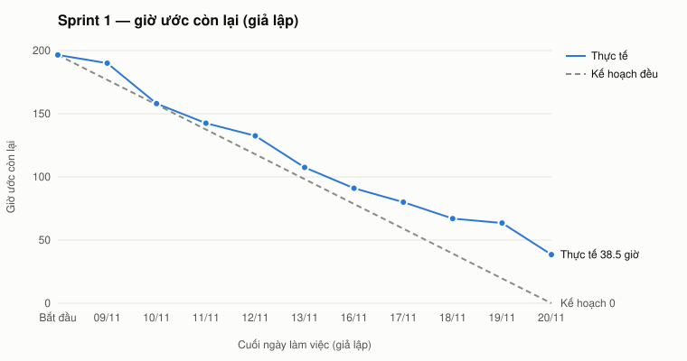

# Báo cáo tiến độ — Sprint 1 · Product A (桜湾水産市場)

**Iteration trên Project:** `Sprint 1` (https://github.com/users/luantv-2208/projects/1/views/3 — view nhóm theo Iteration)
**Khoảng thời gian (giả lập):** 2026-11-09 → 2026-11-20, 10 ngày làm việc, bắt đầu từ kickoff hợp đồng. Trạng thái trên Project được cập nhật như sau một sprint chạy thật; dữ liệu là **giả lập**, áp ngày 2026-10-24 (thời điểm đóng issue trên GitHub là ngày áp, không phải ngày giả lập).
**Nguồn số:** đọc trực tiếp các trường Status, Iteration, SWP, Giờ, Giờ thật của Project; ngày xong từng việc lấy từ nhật ký giả lập.

## 1. Trạng thái

**Sprint 1** — 40 việc cam kết, 141 SWP, 196.5 giờ ước:

| Trạng thái | Số issue | Tổng SWP | Giờ ước | Ghi chú |
|---|---|---|---|---|
| Done | 30 | 108 | 158 | giờ thật 177 / giờ ước 158 (×1.12); đã đóng issue trên GitHub |
| In Progress | 9 | 30 | 33.5 | #22 NEN-14b: làm dở 3.5 / ~13 giờ — người phụ trách hết giờ trong sprint; #114 CLR-06: đã gửi câu hỏi cho khách ngày 2026-11-12, chưa có trả lời; #183 INC-01: làm dở 0.5 / ~4 giờ — người phụ trách hết giờ trong sprint; #224 CLR-01: đã gửi câu hỏi cho khách ngày 2026-11-11, chưa có trả lời; #225 CLR-02: đã gửi câu hỏi cho khách ngày 2026-11-11, chưa có trả lời; #263 CLR-04: đã viết hai phương án, chờ buổi review kiến trúc tuần sau; #374 H-01: đã gửi câu hỏi cho khách ngày 2026-11-10, chưa có trả lời; #380 H-07: đã gửi câu hỏi cho khách ngày 2026-11-12, chưa có trả lời; #381 H-08: đã gửi câu hỏi cho khách ngày 2026-11-11, chưa có trả lời |
| Todo | 1 | 3 | 5 | #16 NEN-10: chưa bắt đầu — 6 câu hỏi chuyên gia về log-convention chưa trả lời |
| **Tổng** | 40 | 141 | 196.5 |  |

**Toàn backlog** (việc chấm trực tiếp, không tính epic / issue cha):

| Trạng thái | Số issue | Tổng SWP | Giờ ước | Ghi chú |
|---|---|---|---|---|
| Done | 33 | 108 | 158 | 30 việc Sprint 1 + 3 quyết định chốt khi break (H-03, H-05, H-06) |
| In Progress | 9 | 30 | 33.5 | đều thuộc Sprint 1 |
| Todo | 247 | 1151 | 1914.5 | gồm 21 mục bị chặn / OPTION chưa xếp sprint |
| **Tổng** | 289 | 1289 | 2106 |  |

## 2. Burndown

| Ngày | Kế hoạch còn lại (giờ) | Thực tế còn lại (giờ) | Xong trong ngày (giờ ước) |
|---|---|---|---|
| Bắt đầu | 196.5 | 196.5 | — |
| 09/11 | 176.8 | 190 | 6.5 |
| 10/11 | 157.2 | 158 | 32 |
| 11/11 | 137.5 | 142.5 | 15.5 |
| 12/11 | 117.9 | 132.5 | 10 |
| 13/11 | 98.2 | 107.5 | 25 |
| 16/11 | 78.6 | 91 | 16.5 |
| 17/11 | 59 | 80 | 11 |
| 18/11 | 39.3 | 67 | 13 |
| 19/11 | 19.6 | 63.5 | 3.5 |
| 20/11 | 0 | 38.5 | 25 |

**Lệch kế hoạch ở đâu:**
- **09/11 chậm, 10/11 bắt kịp.** Ngày đầu chỉ xong 6.5 giờ (kickoff, các việc dài đang dở); ngày 10/11 xong 32 giờ nhờ nhiều việc nhỏ (tài liệu, quyết định nội bộ) cùng xong — đường thực tế chạm lại đường kế hoạch.
- **Từ 11/11 tụt dần, khoảng cách lớn nhất 19/11.** Ba việc nền tảng vượt giờ ăn hết giờ của BE-1, BE-2: NEN-12 xong 12/11 (PITR cần nâng gói Supabase, ×1,4), NEN-20 xong 13/11 (hồi quy aal2 lộ 3 function cũ đọc vai trực tiếp, ×1,75), spike runtime worker NEN-14a kéo tới 20/11 (giới hạn thời gian route Cron trên Vercel, phải thử thêm Edge Function, ×1,5) — ngày 19/11 chỉ xong 3.5 giờ.
- **Vượt giờ đẩy việc ra khỏi sprint.** BE-1 hết giờ khi khung worker NEN-14b mới làm 3,5 / ~13 giờ; BE-2 hết giờ khi INC-01 (ràng buộc 完納奨励金) mới bắt đầu. Hai việc này không khó hơn ước — chúng bị việc trước lấn.
- **Sáu task cần khách vẫn mở.** Câu hỏi đã gửi 10–12/11 nhưng chưa có trả lời (CLR-01 Q-35 nguồn 支払日, CLR-02, CLR-06, H-01, H-07, H-08); H-01 quá hạn 13/11. Giờ làm phía đội đã tiêu, nhưng theo định nghĩa xong chưa được Done nên đường thực tế không về 0.
- **Kết quả:** xong 158 / 196.5 giờ ước (80%), còn 38.5 giờ chuyển sang Sprint 2. Với việc đã xong, giờ thật / giờ ước = **1.12**.
- **Dự báo ngày xong** (theo từng dev, vì lịch kết thúc khi người chậm nhất xong): BE-2 còn 644 giờ ước, Sprint 1 làm xong 52 giờ ước → cần thêm 13 sprint → xong khoảng **2027-05-21** (Sprint 14), so với kế hoạch Sprint 14 và mốc xong hiện thực 2027-05-28. Các dev khác: BE-1 Sprint 13, FE-1 Sprint 8, QA-1 Sprint 4.

## 3. Rủi ro trễ

| Rủi ro | Issue | Ảnh hưởng tới mốc nào | Hành động | Ai làm, khi nào |
|---|---|---|---|---|
| Câu hỏi chặn chưa có trả lời sau 2 tuần (kế hoạch LAB-1: câu mức Chặn phải trả lời trong 2 tuần đầu sau kickoff) | #224 CLR-01, #225 CLR-02, #114 CLR-06, #374 H-01, #380 H-07, #381 H-08 | Tính thưởng F06 (Sprint 5–9) và mốc xong hiện thực 2027-05-28; H-01 đổi phạm vi báo giá F14 | Gửi lại bằng tiếng Nhật kèm phương án mặc định và hạn trả lời; quá hạn thì áp giả định PREMISE A-01 (支払日 nhập tay) và ghi thành rủi ro chấp nhận; đưa vào họp định kỳ khung 11:00 JST | PM-1 + BrSE-1 — gửi 2026-11-23, chốt 2026-11-27 |
| BE-2 (middle) là nút thắt: giữ F05, F06 ràng buộc, F07, F11, F13; làm tới Sprint 13 trong khi BE-1 rảnh từ Sprint 10; Sprint 1 BE-2 đã tràn | #183 INC-01, #215 INC-23, F07 / F13 | Xong hiện thực 2027-05-28 (dư 1 tuần sau Sprint 14); rehearsal migration vòng 1 2027-04-30 | Chuyển phần code F07 (RPT-*) và F13 (OPS-*) sang BE-1 từ Sprint 3; BE-1 review chéo INC-20 / INC-23 | PM-1 — tại planning Sprint 2, 2026-11-23 |
| Ước thấp có hệ thống: LAB-5 263 MD so với LAB-1 407 MD; Sprint 1 chỉ xong 80 % cam kết | toàn backlog | Dự báo xong 2027-05-21 nếu giữ tốc độ, so với mốc 2027-05-28 | Theo dõi giờ thật / giờ ước thêm 2 sprint; cam kết Sprint 2 bằng tốc độ thật (~160 giờ) thay vì năng lực lý thuyết; giữ 15 % buffer của LAB-1 cho phần review / sửa | PM-1 — báo cáo lại cuối Sprint 3, 2026-12-18 |
| Khung worker chưa xong → sinh CSV / PDF, gửi email, chuyển cold bị chặn | #22 NEN-14b, #230 RPT-04, #277 TSU-04a, #338 OPS-09 | Báo cáo F07 và thông báo F09 (Sprint 2–5) | Ưu tiên số 1 của BE-1 đầu Sprint 2; chốt Edge Function + pg_net theo kết luận spike | BE-1 — xong trước 2026-11-25 |
| PITR / gói Supabase chưa được duyệt chi phí — RPO 15 phút chưa bảo đảm | #15 NEN-12, #334 OPS-06 | Rehearsal vòng 1 2027-04-30; nghiệm thu ACC-03 (RPO / RTO) | Gửi khách đề xuất chi phí gói có PITR; tạm dùng môi trường rehearsal không PITR | PM-1 — gửi 2026-11-27, cần duyệt trước 2026-12-11 |
| Việc > 16 giờ sắp vào sprint chưa tách | #104 SE-04a (24 giờ, Sprint 2); #122 MD-08, #320 IKO-17b (Sprint 3) | Cam kết Sprint 2–3 sai; hàng đợi offline 相対 / せり | Tách thành sub-issue ≤ 16 giờ, ước lại, chấm SWP lại bằng skill | BrSE-1 + BE-1 — trước planning Sprint 2, 2026-11-23 |
